<!--
  Every image below is rendered by scripts/generate.mjs (run daily by .github/workflows/profile.yml)
  and published to the `output` branch. To change the content, edit scripts/profile.config.mjs.
-->

<a href="https://grilo.net">
  <picture>
    <source media="(prefers-color-scheme: dark)" srcset="https://raw.githubusercontent.com/PedroGrilo/PedroGrilo/output/hero-dark.svg" />
    <source media="(prefers-color-scheme: light)" srcset="https://raw.githubusercontent.com/PedroGrilo/PedroGrilo/output/hero-light.svg" />
    
  </picture>
</a>

  <a href="https://grilo.net"><picture><source media="(prefers-color-scheme: dark)" srcset="https://raw.githubusercontent.com/PedroGrilo/PedroGrilo/output/link-portfolio-dark.svg" /><source media="(prefers-color-scheme: light)" srcset="https://raw.githubusercontent.com/PedroGrilo/PedroGrilo/output/link-portfolio-light.svg" /></picture></a>
  <a href="https://www.linkedin.com/in/prxpgrilo/"><picture><source media="(prefers-color-scheme: dark)" srcset="https://raw.githubusercontent.com/PedroGrilo/PedroGrilo/output/link-linkedin-dark.svg" /><source media="(prefers-color-scheme: light)" srcset="https://raw.githubusercontent.com/PedroGrilo/PedroGrilo/output/link-linkedin-light.svg" /></picture></a>
  <a href="mailto:pedro@grilo.net"><picture><source media="(prefers-color-scheme: dark)" srcset="https://raw.githubusercontent.com/PedroGrilo/PedroGrilo/output/link-email-dark.svg" /><source media="(prefers-color-scheme: light)" srcset="https://raw.githubusercontent.com/PedroGrilo/PedroGrilo/output/link-email-light.svg" /></picture></a>
  <a href="https://www.youtube.com/@ohsekkicas"><picture><source media="(prefers-color-scheme: dark)" srcset="https://raw.githubusercontent.com/PedroGrilo/PedroGrilo/output/link-youtube-dark.svg" /><source media="(prefers-color-scheme: light)" srcset="https://raw.githubusercontent.com/PedroGrilo/PedroGrilo/output/link-youtube-light.svg" /></picture></a>

## About me

I'm a Senior Frontend Engineer based in Lisbon with 6+ years of experience turning complex products into fast, accessible interfaces, from reusable component libraries to real-time, collaborative map editors.

- **Day job:** building web products with React, Vue.js and TypeScript at LinkRoad.
- **Background:** MSc in Computer Science and Engineering at [NOVA FCT](https://www.fct.unl.pt). My thesis, [LAND IT](https://landit.pt), brought real-time collaborative map editing to wildfire-resilient land planning and was graded 19/20.
- **After hours:** Rust and Tauri desktop apps, Home Assistant integrations and a home lab that keeps asking for new tools.
- **Off screen:** video games, and editing photos and videos.

## Featured projects

  <a href="https://github.com/PedroGrilo/NASYNCLOUD"><picture><source media="(prefers-color-scheme: dark)" srcset="https://raw.githubusercontent.com/PedroGrilo/PedroGrilo/output/project-nasyncloud-dark.svg" /><source media="(prefers-color-scheme: light)" srcset="https://raw.githubusercontent.com/PedroGrilo/PedroGrilo/output/project-nasyncloud-light.svg" /></picture></a>
  <a href="https://github.com/PedroGrilo/vektor"><picture><source media="(prefers-color-scheme: dark)" srcset="https://raw.githubusercontent.com/PedroGrilo/PedroGrilo/output/project-vektor-dark.svg" /><source media="(prefers-color-scheme: light)" srcset="https://raw.githubusercontent.com/PedroGrilo/PedroGrilo/output/project-vektor-light.svg" /></picture></a>
  <a href="https://github.com/PedroGrilo/ha-fermax-duox-me"><picture><source media="(prefers-color-scheme: dark)" srcset="https://raw.githubusercontent.com/PedroGrilo/PedroGrilo/output/project-ha-fermax-duox-me-dark.svg" /><source media="(prefers-color-scheme: light)" srcset="https://raw.githubusercontent.com/PedroGrilo/PedroGrilo/output/project-ha-fermax-duox-me-light.svg" /></picture></a>
  <a href="https://github.com/PedroGrilo/ac-ha-card"><picture><source media="(prefers-color-scheme: dark)" srcset="https://raw.githubusercontent.com/PedroGrilo/PedroGrilo/output/project-ac-ha-card-dark.svg" /><source media="(prefers-color-scheme: light)" srcset="https://raw.githubusercontent.com/PedroGrilo/PedroGrilo/output/project-ac-ha-card-light.svg" /></picture></a>
  <a href="https://github.com/PedroGrilo/shopping-list-plus-card"><picture><source media="(prefers-color-scheme: dark)" srcset="https://raw.githubusercontent.com/PedroGrilo/PedroGrilo/output/project-shopping-list-plus-card-dark.svg" /><source media="(prefers-color-scheme: light)" srcset="https://raw.githubusercontent.com/PedroGrilo/PedroGrilo/output/project-shopping-list-plus-card-light.svg" /></picture></a>
  <a href="https://github.com/PedroGrilo/immich-bulk-import"><picture><source media="(prefers-color-scheme: dark)" srcset="https://raw.githubusercontent.com/PedroGrilo/PedroGrilo/output/project-immich-bulk-import-dark.svg" /><source media="(prefers-color-scheme: light)" srcset="https://raw.githubusercontent.com/PedroGrilo/PedroGrilo/output/project-immich-bulk-import-light.svg" /></picture></a>

More of my work lives on the web:

| Project | What it is |
| --- | --- |
| [LAND IT](https://landit.pt) | Real-time collaborative map editing for wildfire-resilient land planning (MSc thesis, 19/20) |
| [Skin Spectrum](https://skinspectrum.skin) | Visual web platform for Counter-Strike 2 skins |
| [Ormuz Watch](https://ormuz-watch.vercel.app) | Live monitoring dashboard for the Strait of Hormuz |
| [Autárquicas 2025](https://autarquicas2025.vercel.app) | Candidate explorer for the 2025 Portuguese local elections |
| [GDAL Java Guide](https://gdal-java-guide.vercel.app) | Build guide for GDAL's Java bindings on Apple Silicon |
| [Helicopter WebGL](https://pedrogrilo.github.io/Helicopter-WebGL/) | Interactive 3D helicopter over a stylised city |

## Repo Snake

A snake that plays itself, and the food is real: every bite is one of my public repositories, newest first.

<picture>
  <source media="(prefers-color-scheme: dark)" srcset="https://raw.githubusercontent.com/PedroGrilo/PedroGrilo/output/repo-snake-dark.svg" />
  <source media="(prefers-color-scheme: light)" srcset="https://raw.githubusercontent.com/PedroGrilo/PedroGrilo/output/repo-snake-light.svg" />
  
</picture>

## Toolbox

<picture>
  <source media="(prefers-color-scheme: dark)" srcset="https://raw.githubusercontent.com/PedroGrilo/PedroGrilo/output/stack-dark.svg" />
  <source media="(prefers-color-scheme: light)" srcset="https://raw.githubusercontent.com/PedroGrilo/PedroGrilo/output/stack-light.svg" />
  
</picture>

## GitHub activity

  <picture><source media="(prefers-color-scheme: dark)" srcset="https://raw.githubusercontent.com/PedroGrilo/PedroGrilo/output/stats-dark.svg" /><source media="(prefers-color-scheme: light)" srcset="https://raw.githubusercontent.com/PedroGrilo/PedroGrilo/output/stats-light.svg" /></picture>
  <picture><source media="(prefers-color-scheme: dark)" srcset="https://raw.githubusercontent.com/PedroGrilo/PedroGrilo/output/languages-dark.svg" /><source media="(prefers-color-scheme: light)" srcset="https://raw.githubusercontent.com/PedroGrilo/PedroGrilo/output/languages-light.svg" /></picture>

  Every image on this page is rendered by a small dependency-free <a href="https://github.com/PedroGrilo/PedroGrilo/blob/main/scripts/generate.mjs">Node.js script</a> and refreshed daily by <a href="https://github.com/PedroGrilo/PedroGrilo/blob/main/.github/workflows/profile.yml">GitHub Actions</a>.

